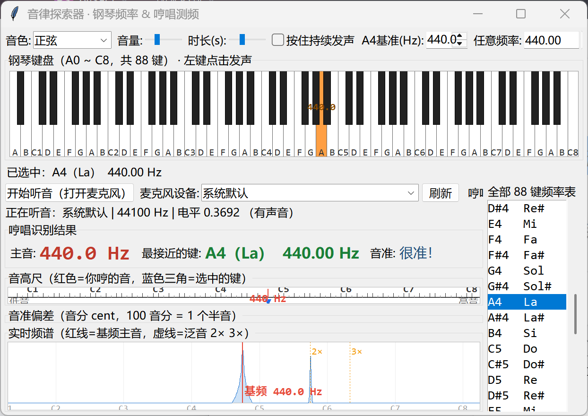

# 音律探索器 Sound Explorer

[English](README_EN.md) | 简体中文

一个用 Python + Tkinter 写的乐音学习小工具，适合给孩子（以及任何人）直观地理解
**音高、频率与十二平均律**：钢琴 88 键的频率一目了然，点一下就能听；
对着麦克风哼一个音，屏幕上会告诉你 —— 你唱的是哪个键、有多准、差多少音分。



## 功能

- **钢琴键盘**：完整 88 键（A0–C8），白键 / 黑键可点击发声，鼠标悬停显示「音名（唱名）+ 频率」，
  勾选「按住持续发声」后松开鼠标才停止，像真琴一样
- **频率表**：右侧列出全部 88 键的「音名 + 唱名 + 频率」，点一下即播放，选中的键在键盘上高亮
- **音色与参数**：正弦 / 三角波 / 方波 / 锯齿波（加性合成，谐波按奈奎斯特频率截断，无混叠失真）；
  音量、时长可调；**A4 基准频率 400–460 Hz 可调**（改成 432 就能看到“标准音一变，全部频率跟着变”）
- **演示**：C 大调音阶、C 大调和弦、八度对比
- **哼唱测频**：麦克风实时采集（**设备可自选**），显示
  - 实时频谱（40 Hz–5 kHz 对数坐标，标注 C1–C8），红色线标出基频主音，橙色虚线标出 2×/3× 泛音
  - 主音频率（YIN 算法）+ 最接近的音名（含唱名）+ 音准偏差（音分）
  - **音高尺**：把你的音高放到钢琴键的标尺上，一眼看出“唱到了哪”
  - **音准指针**：-50 ~ +50 音分的刻度尺，告诉你该唱高一点还是低一点
- **双语界面**：中文 / English 一键切换（界面右上角），或启动时 `--lang en`

## 安装与运行

```bash
# Python 3.8+
pip install -r requirements.txt        # numpy + sounddevice

python sound.py                        # 中文界面
python sound.py --lang en              # English UI
```

> Windows 第一次使用麦克风时，请在 系统设置 → 隐私和安全性 → 麦克风 中允许桌面应用访问。

## 使用建议（陪孩子玩的玩法）

1. 先点几个琴键，感受音高和频率的关系：**频率翻倍 = 高一个八度**
2. 播放 A4=440 Hz，再哼一个音，看音准指针怎么把你“拉回”绿色区域
3. 把 A4 改成 432 Hz，再看频率表全部变化 —— 理解“标准音”是人为约定的
4. 用“方波”和“正弦”播同一个音，对照频谱上的 2×/3× 泛音，理解“音色”为什么不同

## 实现说明

| 部分 | 方法 |
|---|---|
| 音色合成 | 加性合成，只累加奈奎斯特频率以下的谐波，避免混叠；带起振/收尾包络防爆音 |
| 基频检测 | **YIN** 自相关 + 累积均值归一化差分 + 抛物线插值 + 中值平滑；带双重阈值，纯噪声不会误报成低音 |
| 频谱 | FFT（16384 点 + 汉宁窗），按对数频率轴分列取峰值，指数平滑显示 |

纯音与含泛音信号实测误差 < 1 音分；单次分析约 5 ms，实时运行流畅。

## 项目结构

```
sound-explorer/
├── sound.py               # 全部代码（单文件，无其它依赖）
├── requirements.txt
├── README.md              # 中文说明
├── README_EN.md           # English readme
├── LICENSE
└── docs/
    ├── screenshot.png     # 中文界面截图
    └── screenshot_en.png  # English UI screenshot
```

## License

MIT
