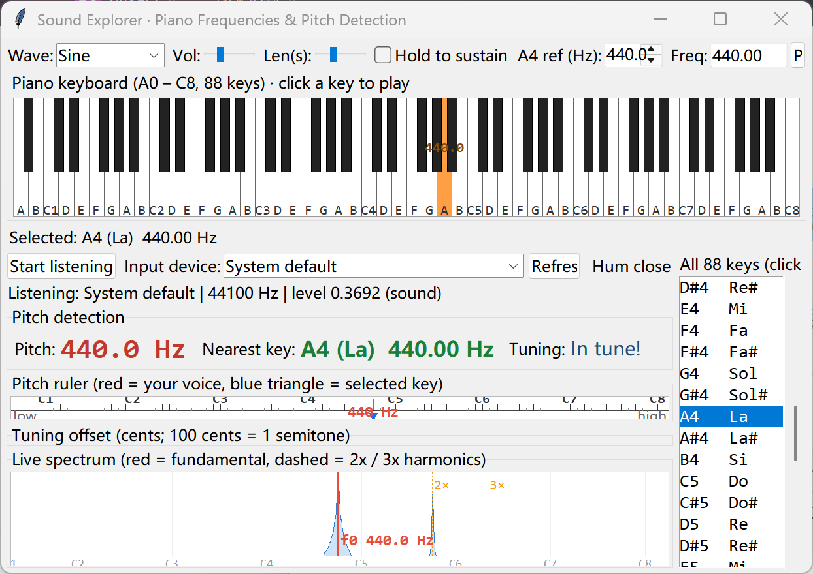

# Sound Explorer 音律探索器

English | [简体中文](README.md)

A small Python + Tkinter app for learning **pitch, frequency and 12-tone equal temperament**
by ear — great for kids. See the frequency of every piano key and hear it with one click,
then hum into the microphone and the app tells you **which key you sang, how in-tune you are,
and by how many cents**.



## Features

- **Piano keyboard** — all 88 keys (A0–C8), click to play; hovering shows note name (solfege) and
  frequency; "hold to sustain" works like a real piano
- **Frequency table** — every key listed as `note · solfege · frequency`; click to play, selected
  key is highlighted on the keyboard
- **Tone & parameters** — sine / triangle / square / sawtooth (additive synthesis, harmonics
  band-limited to Nyquist, alias-free); adjustable volume and length; **A4 reference 400–460 Hz**
  (set it to 432 and watch every frequency shift)
- **Demos** — C major scale, C major chord, octave comparison
- **Pitch detection** — live microphone input (**device selectable**), showing
  - live spectrum (40 Hz–5 kHz, log axis, C1–C8 grid), fundamental marked in red, 2×/3× harmonics
    dashed in orange
  - fundamental frequency (**YIN** algorithm) + nearest note (with solfege) + tuning offset in cents
  - **pitch ruler** — places your hummed note on a keyboard ruler
  - **tuning needle** — a ±50-cent gauge telling you to sing higher or lower
- **Bilingual UI** — 中文 / English switch in the top-right corner, or launch with `--lang zh`

## Install & run

```bash
# Python 3.8+
pip install -r requirements.txt        # numpy + sounddevice

python sound.py                        # English UI on this example
python sound.py --lang zh              # 中文界面
```

> On Windows, allow desktop apps to use the microphone under
> Settings → Privacy & security → Microphone.

## Implementation notes

| Part | Method |
|---|---|
| Synthesis | additive synthesis, harmonics limited below Nyquist (no aliasing), attack/release envelope |
| Pitch | **YIN** autocorrelation + cumulative-mean-normalized difference + parabolic interpolation + median smoothing, with dual thresholds so noise is never reported as a low note |
| Spectrum | FFT (16384 points, Hann window), log-frequency columns, exponential visual smoothing |

Measured error < 1 cent on pure and harmonic-rich tones; ~5 ms per analysis frame.

## Project layout

```
sound-explorer/
├── sound.py               # all of the code (single file, no extra deps)
├── requirements.txt
├── README.md              # 简体中文
├── README_EN.md           # this file
├── LICENSE
└── docs/
    ├── screenshot.png     # 中文界面
    └── screenshot_en.png  # English UI
```

## License

MIT
